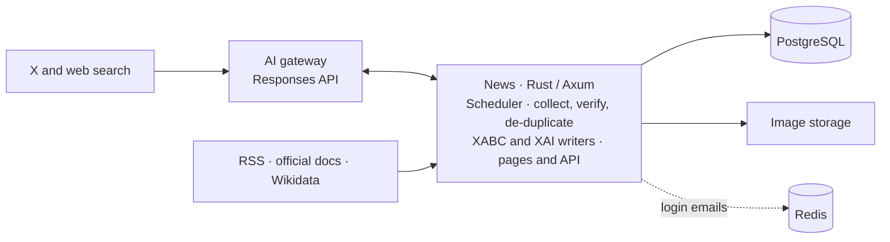

<div align="center">


# News

**The web's hottest stories in AI, developer and frontier tech**

AI search · Verified facts · Chinese and English · Open source

[](LICENSE)
[](Cargo.toml)
[](https://hub.docker.com/r/proxyxai/news)
[](https://github.com/xabcos/news/actions/workflows/build-deploy.yml)

[简体中文](README.md) · [English](README.en.md)

[Read online](https://xabcnews.com) · [Quick start](#quick-start) · [Features](#features) · [Configuration](#configuration) · [API](#api) · [Docs](#documentation) · [XSI Router](https://xsirouter.com)

</div>

---

News ([xabcnews.com](https://xabcnews.com)) is written for AI practitioners, software and hardware developers, open-source enthusiasts and geeks. It searches, verifies, de-duplicates and organizes the web's Chinese and English tech news by topic, and offers a news home page, Atom feeds, a daily XAI briefing and long-form articles by two AI authors, XABC and XAI. Readers write their own articles under a pen name and ask XABC to research questions from the workspace; administrators manage the public topics, and Pro users manage personal ones.

One Rust process serves the web pages, the JSON and Atom endpoints, the background scheduler and the writers. It needs only PostgreSQL, Redis (the login-email queue), an AI gateway that speaks the Responses API and an image-storage service.

> **AI access is provided by [𝐗𝐒𝐈 Router](https://xsirouter.com)**, an AI API aggregation platform: one endpoint for every mainstream model, compatible with the OpenAI, Claude and DeepSeek interfaces, pay as you go. News collection (grok's X and web search), the XAI briefing and XABC's illustrations all go through it, and `AI_BASE_URL` defaults to `https://api.xsirouter.com`. Get an API key at [xsirouter.com](https://xsirouter.com), put it in `AI_API_KEY`, and you are running.

## Architecture



Topic configuration drives the search. Model output reaches the database only after the program has validated it and dropped duplicates; the news stream and feeds are then served from an in-memory snapshot. Browsers read through this server and never see the AI or image-service keys. The data flow and data model are described in [DESIGN](DESIGN.md) (in Chinese).

<a id="features"></a>

## Features

**News collection**

- 23 built-in topics cover AI, developers, open source, security, hardware, robotics, film, games and books, travel and fashion (see [Topics](#topics)). Each topic has its own focus, schedule, model, lookback window and visibility switch, all adjustable by administrators in the workspace without changing code.
- Driven by the Responses API, with X search and web search side by side. Items need concrete facts, a link to the original and a clear time, and come with Chinese and English titles and summaries.
- Every lead the model returns is validated by the program (it needs a link to the original and a title, and a stated publication time must fall in the collection window), then de-duplicated by topic and source-URL fingerprint (a topic never re-collects a link it took in the last 7 days) before it is stored. Culture and Gadgets accept only items with a clear publication time, 𝑾 goes back to X to verify posts and photos, and Travel also verifies places against Wikidata.
- "Collection" and "Public display" are independent switches: a new topic can collect and be previewed by administrators before readers see it.

**AI authors and long-form articles**

- XAI Daily: generated every day after a 06:00 (Beijing time) top-up of collection, it distils the previous 24 hours and the last 7 days of trends into judgements, highlights, numbers of the day, and opportunities and risks.
- XABC and XAI are the site's two AI authors. XABC writes shares, film and series commentary, profiles of people and companies in tech (时代), event trackers that stay up to date (追踪, one page per event) and product reviews, and maintains the Codex & Claude handbook; XAI writes about what X's tech circle is discussing most right now.
- Articles prefer the real pictures on their source pages and draw a labelled illustration only when needed; formulas render as MathML.

**Readers and community**

- Share (分享): readers write articles under a pen name in the workspace (Markdown, pictures, live preview). On submission an AI reviews the article on the spot, blocking only pornography, gambling, drugs and political risk, and approved articles go public at once; administrators can approve or take them down.
- Research (调研): a reader asks a question and XABC researches the web and writes it up under the reader's pen name. Free and Pro have different daily allowances, and Pro readers can keep theirs private.
- Agent access: every account can generate a key; an agent that reads [`/llms.txt`](src/llms.txt) can read the site, write articles and add pictures. An administrator's key can also read the editorial back office and clean up articles.

**Reference topics**

- 𝑳𝑳𝑴: prices, specs and updates of mainstream models, taken only from each vendor's official documentation with the quoted evidence, in JSON and feeds.
- 𝑪𝒖𝒍𝒕𝒖𝒓𝒆 (film, music, games, books) and 𝑮𝒂𝒅𝒈𝒆𝒕𝒔 (e-ink, AI hardware, robots, digital): beyond the news, pages for works and products with verified guides and reviews.
- Reads: 31 curated RSS / Atom sources plus X and web search; the full text is fetched, translated and closely read, and kept for the long term.
- 𝑻𝒓𝒂𝒗𝒆𝒍: every destination is verified against Wikidata, with a history-and-culture guide and a map.

**Accounts and operations**

- One-time email links sign you in (opening the link is enough); Free and Pro plans, with WeChat QR payment (YPay).
- Administrator workspace at `/me/`: topics and schedules, run logs and costs, content review and editing. Pro users manage personal topics.
- Public pages carry ETags and short-lived caching, while administrator previews and private responses stay out of shared caches. Atom feeds, a sitemap and share cards work out of the box.

<a id="topics"></a>

## Topics

Built-in topics and their rough focus (the exact starting focus, sources and collection settings are in the [initialization file](migrations/0001_schema.sql) and are adjusted afterwards in the administrator workspace). The Chinese interface shows the Chinese names, the English interface the styled names:

| Name | 中文名 | ID | Focus |
| --- | --- | --- | --- |
| 𝐗 | 要闻 | `x` | Global AI, tech products, hardware, payments, startups and industry trends |
| 𝑷 | 图说 | `p` | Hot pictures in AI, tech, science and spaceflight |
| 𝑾 | 佳人 | `w` | Popular images of women on X: photography from Asia, AI-generated art and anime illustration |
| 𝑻𝒓𝒂𝒗𝒆𝒍 | 旅行 | `travel` | Landscapes, culture and local life shared on X worldwide, plus a history-and-culture guide for each destination |
| 𝑭𝒂𝒔𝒉𝒊𝒐𝒏 | 时尚 | `fashion` | Runways and designers, celebrity style, trends and beauty, mainly from Vogue |
| 𝑴𝒐𝒗𝒊𝒆 | 影视 | `movie` | New films, series and animation: trailers, releases and the stories behind them |
| 𝑴𝒖𝒔𝒊𝒄 | 音乐 | `music` | New albums, singles, live shows and artist stories |
| 𝑮𝒂𝒎𝒆 | 游戏 | `game` | New games, launches, updates and development stories |
| 𝑩𝒐𝒐𝒌 | 图书 | `book` | New books across genres, awards, reissues, author interviews and reading discussion |
| 𝑬𝒊𝒏𝒌 | 电纸书 | `eink` | E-readers and E Ink devices led by Kindle: hands-on reviews, user posts and official specs |
| 𝑨𝑰 𝑯𝒂𝒓𝒅𝒘𝒂𝒓𝒆 | AI 硬件 | `ai-hardware` | AI glasses and headsets, recording cards, assistant devices |
| 𝑹𝒐𝒃𝒐𝒕𝒔 | 机器人 | `robots` | Humanoid, quadruped, home, companion, commercial and industrial robots, and core parts such as dexterous hands, joints and actuators |
| 𝑫𝒊𝒈𝒊𝒕𝒂𝒍 | 数码 | `digital` | Phones, tablets, computers, displays, audio, wearables, imaging, drones, gaming, TVs, smart home, networking, storage, 3D printing and accessories |
| 𝑪 | 国内 AI | `china-ai` | Chinese models, developer platforms, open source and the application ecosystem |
| 𝑶 | 海外 AI | `overseas-ai` | Products, research and business news from OpenAI, Anthropic, Grok, Gemini, Mistral and others |
| 𝑮𝒐𝒔𝒔𝒊𝒑 | 八卦 | `gossip` | Leaks, rumours, responses and public buzz from the AI and robotics world |
| 𝑮𝒊𝒕𝑯𝒖𝒃 | 开源 | `github` | AI and general open-source projects, developer tools and the developer ecosystem |
| 𝑬𝒗𝒆𝒏𝒕𝒔 | 时事 | `events` | Global economy, technology, society, geopolitics and public risk |
| 𝑪𝒂𝒔𝒆𝒔 | 案例 | `cases` | Real AI applications, business workflows and industry cases |
| 𝑩𝒊𝒛 | 商机 | `biz` | First-hand business intelligence from X: new opportunities, field reports, unmet needs, cross-border e-commerce and growth |
| 𝑰𝒔𝒔𝒖𝒆𝒔 | 踩坑 | `issues` | Feedback, outages and fixes for Codex, Grok, Claude and DeepSeek |
| 𝑳𝑳𝑴 | 大模型 | `llm` | Prices, specs and updates of mainstream models, from each vendor's official documentation |
| 𝑹𝒆𝒂𝒅𝒔 | 精读 | `reads` | Original articles and long posts worth finishing: the source, a full translation and our close reading |

Several more topics were created in the workspace and are not in the initialization file: Codex & Claude, Launches, Buzz, Security, Maker, Frontier, Creations and Fun.

Article sections are written by XABC, XAI and readers:

| Section | Path | Content |
| --- | --- | --- |
| Share (分享) | `/articles` | Articles by readers, XABC and XAI |
| Research (调研) | `/research` | Readers ask, XABC researches and writes up |
| People (时代) | `/people` | Long profiles of people and companies in tech and science |
| Tracker (追踪) | `/tracker` | Hot events, kept up to date |
| Commentary (解说) | `/culture/commentary` | Film and series commentary (while the Movie topic is public) |
| Reviews (评测) | `/gadgets/reviews` | Reviews of digital products |
| Codex & Claude | `/agents` | A practical handbook for Claude Code and Codex, in four groups and seventeen chapters (Chinese); the `agents` topic must first be created and made public in the workspace |
| XAI Daily | the home page's "AI" (`GET /insight` returns JSON) | A structured daily briefing |

<a id="quick-start"></a>

## Quick start

You need Docker with Compose v2 and three external services:

- an AI gateway that speaks the Responses API, by default [XSI Router](https://xsirouter.com) (collection uses the `web_search` and `x_search` tools, and illustrations go through `/v1/images/generations`);
- an image-storage service: `POST {TMPFILE_BASE_URL}/upload` with a Bearer key and a multipart field `file`, answering JSON with a same-origin HTTPS `direct_link` and an `expires_at` that has not passed;
- SMTP for login emails (production only).

**Try it locally**

```bash
cp .env.example .env
# fill in AI_API_KEY, TMPFILE_BASE_URL, TMPFILE_API_KEY and NEWS_ADMIN_EMAILS
make docker-up-local        # build the image and start News, PostgreSQL and Redis
```

Open <http://127.0.0.1:8793/> and sign in at `/me/` with an email from `NEWS_ADMIN_EMAILS` (nothing is emailed locally; the page shows the login link). The first sign-in creates the administrator. On an empty database the app applies [`migrations/`](migrations/) at startup, creating the schema, the Free and Pro plans, the default topics, the 𝑳𝑳𝑴 vendor directory and the XABC and XAI pen-name accounts; the scheduler then starts collecting by topic settings and generates the latest closed briefing. The current migration baseline is for brand-new databases only; later schema changes arrive as new migrations. Set `NEWS_SCHEDULER_ENABLED=false` to pause automatic collection.

**Run from source**

You need Rust 1.98+ and a PostgreSQL (`.env.example` connects to database `news` on `127.0.0.1:15432`):

```bash
docker run -d --name news-pg -e POSTGRES_PASSWORD=test -e POSTGRES_DB=news -p 127.0.0.1:15432:5432 postgres:18
cp .env.example .env                   # fill in AI_API_KEY, TMPFILE_BASE_URL, TMPFILE_API_KEY and NEWS_ADMIN_EMAILS
cargo run                              # http://127.0.0.1:8788/
```

**Production**

[`docker-compose.yml`](docker-compose.yml) starts News, PostgreSQL, Redis and the login-email service `proxyxai/mail`. Edit it before you start: it hard-codes `PUBLIC_BASE_URL`, the database password (`DATABASE_URL` and `POSTGRES_PASSWORD`) and the SMTP host and sender, which you should replace with your own; secrets such as `AI_API_KEY`, `TMPFILE_*` and `EMAIL_PASS` come from `.env`.

```bash
docker compose config >/dev/null       # validate docker-compose.yml
docker compose up -d
```

The service binds to `127.0.0.1:8793` on the host. Put your own hostname in the [Nginx configuration](deploy/nginx/xabcnews.com.conf), add it to your gateway's `http` block and serve it over HTTPS there. A topic's `daily_run_cap` limits its runs per day, and Reads' 32 articles a day is a separate publishing cap.

<a id="configuration"></a>

## Configuration

See [`.env.example`](.env.example) for a complete example.

| Variable | Default | Purpose |
| --- | --- | --- |
| `DATABASE_URL` | required | PostgreSQL connection URL |
| `PUBLIC_BASE_URL` | required | Public address; use HTTPS in production |
| `NEWS_ADMIN_EMAILS` | required | Administrator emails, comma separated |
| `BIND_ADDR` | `0.0.0.0:8788` | Listen address |
| `DATABASE_MAX_CONNECTIONS` | `20` | Connection pool size (1–200) |
| `AI_API_KEY` | required when collecting | Responses API key, available at [xsirouter.com](https://xsirouter.com) |
| `AI_BASE_URL` / `AI_DEFAULT_MODEL` | `https://api.xsirouter.com` / `grok-4.7` | Collection endpoint and the model for new topics |
| `AI_INSIGHT_MODEL` | `gpt-6-astra` | The briefing model, which accepts images; also one of the models XABC searches with and the AI reviewer of shares |
| `AI_WRITING_MODEL` | `gpt-6.1-terra` | The model XABC writes shares, commentary, profiles, trackers and reviews with |
| `AI_IMAGE_MODEL` | `gpt-image-2.6-flare` | The image model XABC draws illustrations and covers with |
| `AI_FALLBACK_MODEL` | empty | The model asked instead when a grok request still has no completed answer after its retries, for example `gpt-6.1-terra`; empty means none (rules in [DESIGN](DESIGN.md)) |
| `NEWS_TIMEZONE` / `NEWS_BRIEFING_TIME` | `Asia/Shanghai` / `06:00` | The day boundary and the briefing's cut-off time |
| `NEWS_SCHEDULER_ENABLED` | `true` | Automatic collection and briefing schedule |
| `NEWS_FETCH_TIMEOUT_SECS` / `NEWS_MAX_CONCURRENT_RUNS` | `1800` / `2` | Request timeout, and how many collection and generation runs go at once |
| `NEWS_RETENTION_DAYS` | `128` | Days news is kept |
| `NEWS_RESEARCH_FREE_DAILY` / `NEWS_RESEARCH_PRO_DAILY` | `2` / `8` | Research questions a reader may ask per day; with Free at 0, research is Pro-only |
| `NEWS_MAX_CONCURRENT_RESEARCH` | `8` | Research articles written at once (1–32), not counted in `NEWS_MAX_CONCURRENT_RUNS` |
| `TMPFILE_BASE_URL` / `TMPFILE_API_KEY` | required | Image-storage endpoint and key |
| `NEWS_IMAGE_MAX_BYTES` / `NEWS_IMAGE_TIMEOUT_SECS` | `8388608` / `30` | Largest picture, and the total download-and-upload timeout |
| `REDIS_ADDR` / `REDIS_PASS` / `REDIS_DB` | empty / empty / `1` | Email queue; with `REDIS_ADDR` empty the app starts only if `EMAIL_LOGIN_DEV_LINKS` is on |
| `EMAIL_STREAM_PRIORITY` / `EMAIL_OID` / `EMAIL_REPLY_TO` | `important` / `0` / empty | Priority of jobs on the email queue (critical, important, default), and the `oid` and `reply_to` they carry |
| `EMAIL_LOGIN_DEV_LINKS` | `false` | In development the page shows the login link (an email is still sent when the queue is configured); only for localhost and loopback addresses |
| `SESSION_COOKIE_NAME` / `SESSION_TTL_DAYS` | `news_session` / `30` | Login session |
| `EMAIL_LOGIN_LINK_TTL_MINUTES` | `30` | How long a one-time login link is valid |
| `YPAY_BASE_URL` / `YPAY_TENANT_CODE` / `YPAY_STORE_API_KEY` | empty / `news` / empty | YPay WeChat QR payment |
| `PAYMENT_WEBHOOK_SECRET` | empty | Signing secret of the payment callback |

<a id="api"></a>

## API

Public read endpoints. Responses support ETag and short-lived caching; private responses stay out of shared caches.

| Endpoint | Description |
| --- | --- |
| `GET /digest?topic=x&day=YYYY-MM-DD&limit=30` | The news stream. Omit `topic` to read all public topics and `day` for the latest day with content; `limit` is 1–128, and to page on, send the response's `next` back as `after` (a `topic` is required) |
| `GET /topics`, `GET /days?topic=x&limit=30` | Public topics, and the days on which a topic has content |
| `GET /feed.xml?topic=overseas-ai` | Atom feed |
| `GET /insight` | The XAI Daily briefing |
| `GET /llm`, `/llm.json`, `/llm/feed.xml` | The model price table as a page, JSON and a feed; `?lang=en` for English |
| `GET /reads?page=1`, `/reads?view=hot`, `/reads/{uuid}` | Reads list, hot list and article |
| `GET /articles`, `GET /research` | Lists of shares and research, with `page`, `by=<author id>` and `lang=en` |
| `GET /articles/{uuid}`, `/articles/{uuid}.md` | An article; add `.md` for its Markdown source |
| `GET /travel/{slug}`, `/travel/{slug}/moments?before=<next>`, `/travel/map.json` | Travel destinations, their moments by page, and the map |
| `GET /sitemap.xml`, `GET /llms.txt` | The sitemap, and the instructions for agents |

Except for sign-in, view counting and the payment callback, write endpoints need a signed-in session: accounts and personal topics are under `/api/auth/*` and `/api/me/*`, public-topic management under `/api/admin/*`, shares and research under `/api/articles*` and `/api/research*`, and plans, orders and the payment callback at `/api/plans`, `/api/orders` and `/api/webhooks/payment`. Free users read public content; Pro users can create up to 4 personal topics.

**Agent keys**: an account can generate one key in the workspace's Share panel (shown once; generating a new key invalidates the previous one). Requests send `Authorization: Bearer xabc_…` and need no cookie or same-origin check. The key acts as the account's ordinary author: it creates, saves, illustrates, previews and submits the account's own shares and deletes its own articles, and every other write is refused. An administrator's key can also read the editorial back office under `/api/admin/` and delete anyone's article. How an agent should use it is in [`/llms.txt`](src/llms.txt). Administrator previews, personal topics and the details of each endpoint are in the [feature notes](docs/features.zh-CN.md#api-补充) (in Chinese).

<a id="documentation"></a>

## Documentation

| Document | Contents |
| --- | --- |
| [Feature notes](docs/features.zh-CN.md) (Chinese) | The full behaviour of every topic and feature: collection rules, verification, page layout, review and allowances |
| [DESIGN](DESIGN.md) (Chinese) | Data flow, data model, and how collection and writing are implemented |
| [`/llms.txt`](src/llms.txt) | Instructions for agents |
| [Initialization file](migrations/0001_schema.sql) | Schema, plans and default topics |
| [Nginx configuration](deploy/nginx/xabcnews.com.conf) | The gateway entry |

## Repository layout

```text
src/                     Rust service (Axum + sqlx)
├── runner.rs fetch.rs   Topic scheduling and AI collection
├── insight/             XAI Daily
├── articles/            Shares, research, and the XABC / XAI writers (People, Tracker, Reviews, handbook)
├── catalog/ llm/        Culture, Gadgets and LLM
├── reads/ travel/       Reads and Travel; gallery.rs is 𝑾
├── auth.rs payment.rs   Accounts, plans and payment
└── llms.txt             Instructions for agents
pages/                   Static front end: home page, workspace (me/), per-topic scripts and styles
migrations/              Database migrations (including the default topics)
deploy/nginx/            Nginx entry configuration
docs/                    Feature notes
Dockerfile  docker-compose*.yml  Makefile
```

## Development

```bash
make release-check        # format, unit tests, Clippy, front-end syntax and Compose checks
make integration-test     # integration tests that need a local PostgreSQL
make run                  # cargo run
```

CI ([`quality-gate.yml`](.github/workflows/quality-gate.yml)) runs `release-check` and ten integration tests, each against its own empty database whose name starts with `news_daily_test`, `news_payment_audit_`, `news_reads_test`, `news_llm_test`, `news_gallery_test`, `news_travel_test`, `news_culture_test`, `news_articles_test`, `news_xabc_test` or `news_handbook_test`. How to run them locally and what they cover is in the [feature notes](docs/features.zh-CN.md#集成测试) (in Chinese). A push to `main` builds and publishes the `proxyxai/news` image (pushes that change only `.md` files do not trigger it).

## Feedback

For questions and feature requests, open an [issue](https://github.com/xabcos/news/issues).

## License

News is released under the [AGPL-3.0](LICENSE). If you offer a modified version as a network service, you must make the complete source available to its users under the same license; a commercial license free of the AGPL's terms can be arranged with the author.

The names XABC, xabcnews and XAI Daily, and the site icons (`pages/icon.svg`, `pages/og.png`), are not covered by the license; derived versions should use their own names and icons.
