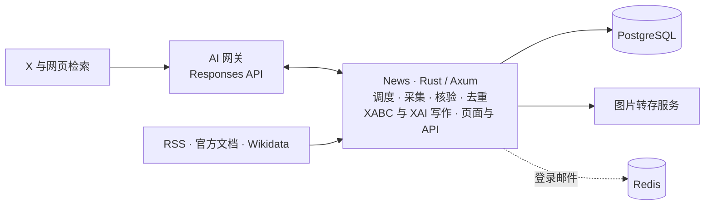

<div align="center">


# News

**AI、开发者与前沿科技的全网热点**

AI 检索 · 事实核验 · 中英双语 · 开源

[](LICENSE)
[](Cargo.toml)
[](https://hub.docker.com/r/proxyxai/news)
[](https://github.com/xabcos/news/actions/workflows/build-deploy.yml)

[简体中文](README.md) · [English](README.en.md)

[在线阅读](https://xabcnews.com) · [快速开始](#quick-start) · [功能](#features) · [配置](#configuration) · [API](#api) · [文档](#documentation) · [XSI Router](https://xsirouter.com)

</div>

---

News（[xabcnews.com](https://xabcnews.com)）面向 AI 实践者、软硬件开发者、开源爱好者和极客：按栏目检索、核验、去重并整理全网的中英文科技热点，提供新闻首页、Atom 订阅、每日 XAI 日报，以及 XABC 与 XAI 两位 AI 作者的长文。读者可以在工作台用自己的笔名写分享、向 XABC 提问调研，管理员管理公共栏目，Pro 用户管理个人主题。

一个 Rust 进程同时承担网页、JSON / Atom 接口、后台调度与写作，只依赖 PostgreSQL、Redis（登录邮件队列）、一个兼容 Responses API 的 AI 网关和一个图片转存服务。

> **AI 接口由 [𝐗𝐒𝐈 Router](https://xsirouter.com) 提供**：AI API 聚合平台，一个入口调用全部主流大模型，兼容 OpenAI、Claude、DeepSeek 接口，充值即用。本项目的新闻采集（grok 的 X 与网页检索）、XAI 日报和 XABC 配图都经它调用，`AI_BASE_URL` 默认就是 `https://api.xsirouter.com`：在 [xsirouter.com](https://xsirouter.com) 取得 API Key，填入 `AI_API_KEY` 即可运行。

## 架构



栏目配置驱动检索；模型的输出经程序校验和去重才入库，新闻流与订阅再由内存快照提供。浏览器只经本站读取内容，不接触 AI 或图片服务的密钥。数据流与数据模型见 [DESIGN](DESIGN.md)。

<a id="features"></a>

## 功能

**新闻采集**

- 内置 23 个栏目，覆盖 AI、开发者、开源、安全、硬件、机器人、影视游戏图书、旅行与时尚等方向（见[栏目](#topics)）。每个栏目有自己的关注方向、排程、模型、回看时长与展示开关，管理员在工作台随时调整，不必改代码。
- 以 Responses API 驱动，X 检索与网页检索并用，要求具体事实、原文链接与明确时间，输出中英文标题与摘要。
- 模型给出的每条线索都由程序校验（要有原文链接和标题，给出的发布时间须在采集窗口内），再按栏目与原文地址指纹去重（栏目 7 天内不重复收录）才会入库；Culture 与 𝑮𝒂𝒅𝒈𝒆𝒕𝒔 只收发布时间明确的消息，𝑾 回到 X 核验帖子与照片，𝑻𝒓𝒂𝒗𝒆𝒍 还用 Wikidata 核实地点。
- 「启用抓取」与「前台展示」相互独立：新栏目可以先采集、由管理员预览，再对读者公开。

**AI 作者与长文**

- XAI 日报：每天北京时间 06:00 补采后生成，提炼前 24 小时要闻与最近 7 天趋势，给出判断、看点、今日数字与机会风险。
- XABC 与 XAI 是站内的两位 AI 作者：XABC 写分享、解说、时代（科技人物与企业）、追踪（热点事件，一件事一篇、持续更新）与评测（数码产品），并维护「Codex & Claude」手册；XAI 写 X 科技圈此刻讨论最热的话题。
- 文章优先使用来源页面里的真实图片，必要时才画示意图并标注；公式按 MathML 渲染。

**读者创作与社区**

- 分享：读者用笔名在工作台写文章（Markdown、图片、实时预览），提交后 AI 当场审核，只拦黄赌毒与政治风险，通过即公开；管理员可放行或下线。
- 调研：读者提问，XABC 联网调研后以提问人的笔名成文；Free 与 Pro 的每日额度不同，Pro 可以不公开。
- Agent 接入：每个账户可以生成一把密钥，agent 读 [`/llms.txt`](src/llms.txt) 就能读站、写文章并配图；管理员的密钥还能读编辑后台、清理文章。

**资料型栏目**

- 𝑳𝑳𝑴：全球主流模型的价格、规格与更新，数据只取服务商官方文档并附原文证据；提供 JSON 与订阅。
- 𝑪𝒖𝒍𝒕𝒖𝒓𝒆（影视、音乐、游戏、图书）与 𝑮𝒂𝒅𝒈𝒆𝒕𝒔（电纸书、AI 硬件、机器人、数码）：新闻之外有作品与产品资料页、核验过的导读与评测。
- Reads：31 个精选 RSS / Atom 来源，加 X 与全网检索，抓取原文全文，给出翻译与精读，长期保留。
- 𝑻𝒓𝒂𝒗𝒆𝒍：每个目的地经 Wikidata 核实，配历史文化导读与地图。

**账户与运营**

- 邮箱一次性链接登录（打开链接即登录）；Free / Pro 套餐，微信扫码支付（YPay）。
- 过客账户自动清理：一年没有登录，且没有订单与支付记录、没开通过 Pro、没有自建主题、没写过文章、没有 Agent 密钥的账户每小时清理一次，再来登录即重新注册；已停用的账户不清理。
- 管理员工作台 `/me/`：栏目与排程、运行记录与花费、内容审核与编辑；Pro 用户管理个人主题。
- 公共页面带 ETag 与短期缓存，管理员预览与私有响应不进共享缓存；Atom 订阅、站点地图与分享卡片开箱即用。

<a id="topics"></a>

## 栏目

内置栏目与大致的关注方向（确切的初始方向、关注来源与采集参数以[初始化文件](migrations/0001_schema.sql)为准，之后在管理员工作台调整）：

| 名称 | ID | 关注方向 |
| --- | --- | --- |
| 要闻（𝐗） | `x` | 全球 AI、科技产品、硬件、支付、创业与产业趋势 |
| 图说（𝑷） | `p` | AI、科技、科学与航天的热点图片 |
| 佳人（𝑾） | `w` | X 上正在传播的美丽女性图片：亚洲真人摄影、AI 美女与动漫插画 |
| 旅行（𝑻𝒓𝒂𝒗𝒆𝒍） | `travel` | 世界各地在 X 上分享的风景、人文与当地生活中的人，以及目的地的历史文化导读 |
| 时尚（𝑭𝒂𝒔𝒉𝒊𝒐𝒏） | `fashion` | 以 Vogue 为主的秀场与设计师、明星穿搭与红毯、潮流趋势与单品和美妆 |
| 影视（𝑴𝒐𝒗𝒊𝒆） | `movie` | 全球电影、剧集与动画的新作、预告、上映及创作故事 |
| 音乐（𝑴𝒖𝒔𝒊𝒄） | `music` | 全球新专辑、单曲、音乐现场及音乐人故事 |
| 游戏（𝑮𝒂𝒎𝒆） | `game` | 全球游戏的新作、发售、更新及开发故事 |
| 图书（𝑩𝒐𝒐𝒌） | `book` | 全品类新书、获奖、再版、作者访谈与阅读讨论 |
| 电纸书（𝑬𝒊𝒏𝒌） | `eink` | 以 Kindle 为首的电纸书与墨水屏设备：真实测评、用户分享与官方参数 |
| AI 硬件（𝑨𝑰 𝑯𝒂𝒓𝒅𝒘𝒂𝒓𝒆） | `ai-hardware` | AI 眼镜与头显、录音卡片、助手设备等 AI 硬件 |
| 机器人（𝑹𝒐𝒃𝒐𝒕𝒔） | `robots` | 人形、四足与机器狗、家用与陪伴、商用与工业机器人，以及灵巧手、关节与执行器等核心部件 |
| 数码（𝑫𝒊𝒈𝒊𝒕𝒂𝒍） | `digital` | 手机、平板、电脑、显示器、音频、穿戴、影像、无人机、游戏、电视与投影、家居、网络与存储、3D 打印、趣玩与配件 |
| 国内 AI（𝑪） | `china-ai` | 中国模型、开发平台、开源与应用生态 |
| 海外 AI（𝑶） | `overseas-ai` | OpenAI、Anthropic、Grok、Gemini、Mistral 等海外 LLM 的产品、研究与商业动态 |
| 八卦（𝑮𝒐𝒔𝒔𝒊𝒑） | `gossip` | AI 与机器人圈的爆料、传闻、回应与公开热议 |
| 开源（𝑮𝒊𝒕𝑯𝒖𝒃） | `github` | AI 与通用开源项目、开发工具与开发者生态 |
| 时事（𝑬𝒗𝒆𝒏𝒕𝒔） | `events` | 全球经济、科技、社会、国际局势与公共风险 |
| 案例（𝑪𝒂𝒔𝒆𝒔） | `cases` | 真实 AI 应用、业务流程与行业案例 |
| 商机（𝑩𝒊𝒛） | `biz` | X 上的一手商业信息：新机会、实战复盘、需求痛点、出海电商与获客增长 |
| 踩坑（𝑰𝒔𝒔𝒖𝒆𝒔） | `issues` | Codex、Grok、Claude、DeepSeek 的使用反馈、故障与解决方案 |
| 大模型（𝑳𝑳𝑴） | `llm` | 全球主流大模型的价格、规格与更新，以各服务商官方文档为准 |
| 精读（𝑹𝒆𝒂𝒅𝒔） | `reads` | 值得读完的原创文章与公开长帖，原文、全文翻译与本站精读 |

中文界面用中文名，英文界面用括号里的英文名。线上另有几个在工作台建的栏目，不在初始化文件里：Codex & Claude、AI 新品、热议、安全、创客、前沿、AI 创作与趣图。

文章栏目由 XABC、XAI 与读者写成：

| 栏目 | 路径 | 内容 |
| --- | --- | --- |
| 分享 | `/articles` | 读者、XABC 与 XAI 写的文章 |
| 调研 | `/research` | 读者提问，XABC 联网调研成文 |
| 时代 | `/people` | 科技与科学人物、科技企业的长文 |
| 追踪 | `/tracker` | 热点事件的持续更新 |
| 解说 | `/culture/commentary` | 影视解说（影视栏目公开时） |
| 评测 | `/gadgets/reviews` | 数码产品评测 |
| Codex & Claude | `/agents` | Claude Code 与 Codex 的中文实用手册，四组十七章；需先在工作台建好并公开 `agents` 栏目 |
| XAI 日报 | 首页「AI」（`GET /insight` 返回 JSON） | 每日结构化日报 |

<a id="quick-start"></a>

## 快速开始

需要 Docker 与 Compose v2，以及三样外部服务：

- 兼容 Responses API 的 AI 网关，默认 [XSI Router](https://xsirouter.com)（采集用 `web_search` 与 `x_search` 工具，生图走 `/v1/images/generations`）；
- 图片转存服务：`POST {TMPFILE_BASE_URL}/upload`，Bearer 密钥，multipart 字段 `file`，返回 JSON，含同源的 HTTPS `direct_link` 和尚未过期的 `expires_at`；
- 用于登录邮件的 SMTP（仅生产环境需要）。

**本地试用**

```bash
cp .env.example .env
# 填写 AI_API_KEY、TMPFILE_BASE_URL、TMPFILE_API_KEY 和 NEWS_ADMIN_EMAILS
make docker-up-local        # 构建镜像并启动 News、PostgreSQL 与 Redis
```

打开 <http://127.0.0.1:8793/>，用 `NEWS_ADMIN_EMAILS` 里的邮箱登录 `/me/`（本地不发邮件，页面上直接给出登录链接），首次登录即创建管理员。空库启动时会自动执行 [`migrations/`](migrations/)：创建表结构、Free / Pro 套餐、默认栏目、𝑳𝑳𝑴 服务商目录，以及 XABC 与 XAI 两个笔名账户；之后调度器按栏目配置开始采集，并生成最近一期已截止的日报。当前迁移基线只用于全新数据库，之后的结构变更都是新迁移。`NEWS_SCHEDULER_ENABLED=false` 可暂停自动采集。

**从源码运行**

需要 Rust 1.98+ 和一个 PostgreSQL（`.env.example` 默认连 `127.0.0.1:15432` 的 `news` 库）：

```bash
docker run -d --name news-pg -e POSTGRES_PASSWORD=test -e POSTGRES_DB=news -p 127.0.0.1:15432:5432 postgres:18
cp .env.example .env                   # 填写 AI_API_KEY、TMPFILE_BASE_URL、TMPFILE_API_KEY 和 NEWS_ADMIN_EMAILS
cargo run                              # http://127.0.0.1:8788/
```

**生产部署**

[`docker-compose.yml`](docker-compose.yml) 启动 News、PostgreSQL、Redis 与登录邮件服务 `proxyxai/mail`。启动前先改它：文件里写死了 `PUBLIC_BASE_URL`、数据库密码（`DATABASE_URL` 与 `POSTGRES_PASSWORD`）以及发信用的 SMTP 主机与发件人，请换成你自己的；`AI_API_KEY`、`TMPFILE_*`、`EMAIL_PASS` 等密钥来自 `.env`。

```bash
docker compose config >/dev/null       # 检查 docker-compose.yml
docker compose up -d
```

服务绑定宿主机 `127.0.0.1:8793`；把 [Nginx 配置](deploy/nginx/xabcnews.com.conf) 里的域名换成你的，加入网关的 `http` 配置，并在网关上提供 HTTPS 入口。主题的 `daily_run_cap` 限制每日运行次数，Reads 的每日 32 篇是独立的发布上限。

<a id="configuration"></a>

## 配置

完整示例见 [`.env.example`](.env.example)。

| 变量 | 默认 | 作用 |
| --- | --- | --- |
| `DATABASE_URL` | 必填 | PostgreSQL 连接地址 |
| `PUBLIC_BASE_URL` | 必填 | 对外地址，生产环境使用 HTTPS |
| `NEWS_ADMIN_EMAILS` | 必填 | 管理员邮箱，逗号分隔 |
| `BIND_ADDR` | `0.0.0.0:8788` | 监听地址 |
| `DATABASE_MAX_CONNECTIONS` | `20` | 连接池大小（1–200） |
| `AI_API_KEY` | 启用采集时必填 | Responses API 密钥，在 [xsirouter.com](https://xsirouter.com) 取得 |
| `AI_BASE_URL` / `AI_DEFAULT_MODEL` | `https://api.xsirouter.com` / `grok-4.7` | 采集接口与新建主题的模型 |
| `AI_INSIGHT_MODEL` | `gpt-6-astra` | 支持图片输入的日报模型，也是 XABC 检索素材的模型之一和分享的 AI 审核模型 |
| `AI_WRITING_MODEL` | `gpt-6.1-terra` | XABC 写分享、解说、时代、追踪和评测的模型 |
| `AI_IMAGE_MODEL` | `gpt-image-2.6-flare` | XABC 画插图和封面的生图模型 |
| `AI_FALLBACK_MODEL` | 空 | grok 的请求重试后仍没有完成的回答时改问的模型，如 `gpt-6.1-terra`；空则不替代，规则见 [DESIGN](DESIGN.md) |
| `NEWS_TIMEZONE` / `NEWS_BRIEFING_TIME` | `Asia/Shanghai` / `06:00` | 日期边界和日报截止时间 |
| `NEWS_SCHEDULER_ENABLED` | `true` | 自动采集与日报调度 |
| `NEWS_FETCH_TIMEOUT_SECS` / `NEWS_MAX_CONCURRENT_RUNS` | `1800` / `2` | 请求超时与采集、生成共用并发数 |
| `NEWS_RETENTION_DAYS` | `128` | 新闻保留天数 |
| `NEWS_RESEARCH_FREE_DAILY` / `NEWS_RESEARCH_PRO_DAILY` | `2` / `8` | 每人每天可以调研的次数；Free 设为 0 时调研只对 Pro 开放 |
| `NEWS_MAX_CONCURRENT_RESEARCH` | `8` | 同时写的调研篇数（1–32），不占 `NEWS_MAX_CONCURRENT_RUNS` |
| `TMPFILE_BASE_URL` / `TMPFILE_API_KEY` | 必填 | 图片转存接口与密钥 |
| `NEWS_IMAGE_MAX_BYTES` / `NEWS_IMAGE_TIMEOUT_SECS` | `8388608` / `30` | 单张图片大小与下载、上传总超时 |
| `REDIS_ADDR` / `REDIS_PASS` / `REDIS_DB` | 空 / 空 / `1` | 邮件队列；`REDIS_ADDR` 为空时，只有开启 `EMAIL_LOGIN_DEV_LINKS` 才能启动 |
| `EMAIL_STREAM_PRIORITY` / `EMAIL_OID` / `EMAIL_REPLY_TO` | `important` / `0` / 空 | 写入邮件队列的任务优先级（critical、important、default）、`oid` 与回复地址 |
| `EMAIL_LOGIN_DEV_LINKS` | `false` | 开发环境下页面直接给出登录链接（配置了邮件队列时仍会发信），只允许 localhost 与回环地址 |
| `SESSION_COOKIE_NAME` / `SESSION_TTL_DAYS` | `news_session` / `30` | 登录会话 |
| `EMAIL_LOGIN_LINK_TTL_MINUTES` | `30` | 一次性登录链接有效期 |
| `YPAY_BASE_URL` / `YPAY_TENANT_CODE` / `YPAY_STORE_API_KEY` | 空 / `news` / 空 | YPay 微信扫码支付 |
| `PAYMENT_WEBHOOK_SECRET` | 空 | 支付回调签名密钥 |

<a id="api"></a>

## API

公共读取接口，响应支持 ETag 和短期缓存，私有响应不进共享缓存：

| 接口 | 说明 |
| --- | --- |
| `GET /digest?topic=x&day=YYYY-MM-DD&limit=30` | 新闻流；省略 `topic` 读全部公共栏目，省略 `day` 读最近有内容的日期；`limit` 为 1–128，翻页时把响应里的 `next` 作为 `after` 传回（需指定 `topic`） |
| `GET /topics`、`GET /days?topic=x&limit=30` | 公开栏目，以及栏目有内容的日期 |
| `GET /feed.xml?topic=overseas-ai` | Atom 订阅 |
| `GET /insight` | XAI 日报 |
| `GET /llm`、`/llm.json`、`/llm/feed.xml` | 大模型价格表：页面、JSON 与订阅，`?lang=en` 为英文 |
| `GET /reads?page=1`、`/reads?view=hot`、`/reads/{uuid}` | Reads 列表、热读与文章 |
| `GET /articles`、`GET /research` | 分享与调研列表，参数 `page`、`by=<作者编号>`、`lang=en` |
| `GET /articles/{uuid}`、`/articles/{uuid}.md` | 文章，加 `.md` 取 Markdown 原文 |
| `GET /travel/{slug}`、`/travel/{slug}/moments?before=<next>`、`/travel/map.json` | 旅行目的地、条目分页与地图 |
| `GET /sitemap.xml`、`GET /llms.txt` | 站点地图；写给 agent 的接入说明 |

除登录、阅读计数与支付回调外，写接口都需要登录会话：账户与个人主题在 `/api/auth/*`、`/api/me/*`，公共主题管理在 `/api/admin/*`，分享与调研在 `/api/articles*`、`/api/research*`，套餐、订单与支付回调在 `/api/plans`、`/api/orders`、`/api/webhooks/payment`。Free 用户阅读公共内容，Pro 用户可创建最多 4 个个人主题。

**Agent 密钥**：账户可在工作台「分享」里生成一把密钥（只显示一次，再生成一把即让旧的失效），请求带 `Authorization: Bearer xabc_…`，不需要 Cookie 和同源。密钥是这个账户的普通作者：新建、保存、配图、预览、提交自己的分享并删除自己的文章，其余写操作一律拒绝；管理员的密钥另外能读 `/api/admin/` 之下的编辑后台、删除任何人的文章。接入说明在 [`/llms.txt`](src/llms.txt)。管理员预览、个人主题与各接口的细节见[功能与行为说明](docs/features.zh-CN.md#api-补充)。

<a id="documentation"></a>

## 文档

| 文档 | 内容 |
| --- | --- |
| [功能与行为说明](docs/features.zh-CN.md) | 各栏目与功能的完整行为：采集规则、核验方式、页面排版、审核与额度 |
| [DESIGN](DESIGN.md) | 数据流、数据模型、采集与写作的实现 |
| [`/llms.txt`](src/llms.txt) | 写给 agent 的接入说明 |
| [初始化文件](migrations/0001_schema.sql) | 表结构、套餐与默认栏目 |
| [Nginx 配置](deploy/nginx/xabcnews.com.conf) | 网关入口 |

## 目录结构

```text
src/                     Rust 服务（Axum + sqlx）
├── runner.rs fetch.rs   栏目调度与 AI 采集
├── insight/             XAI 日报
├── articles/            分享、调研与 XABC / XAI 写作线（时代、追踪、评测、手册）
├── catalog/ llm/        Culture、𝑮𝒂𝒅𝒈𝒆𝒕𝒔 与 𝑳𝑳𝑴
├── reads/ travel/       Reads、𝑻𝒓𝒂𝒗𝒆𝒍；gallery.rs 是 𝑾
├── auth.rs payment.rs   账户、套餐与支付
└── llms.txt             写给 agent 的接入说明
pages/                   静态前端：首页、工作台（me/）、各栏目脚本与样式
migrations/              数据库迁移（含默认栏目）
deploy/nginx/            Nginx 入口配置
docs/                    功能与行为说明
Dockerfile  docker-compose*.yml  Makefile
```

## 开发

```bash
make release-check        # 格式、单元测试、Clippy、前端语法与 Compose 检查
make integration-test     # 需要本地 PostgreSQL 的集成测试
make run                  # cargo run
```

CI（[`quality-gate.yml`](.github/workflows/quality-gate.yml)）执行 `release-check` 与十个集成测试，各用一个独立的空库，库名分别以 `news_daily_test`、`news_payment_audit_`、`news_reads_test`、`news_llm_test`、`news_gallery_test`、`news_travel_test`、`news_culture_test`、`news_articles_test`、`news_xabc_test` 和 `news_handbook_test` 开头；本地的运行方式与覆盖范围见[集成测试](docs/features.zh-CN.md#集成测试)。推送到 `main` 会构建并发布 `proxyxai/news` 镜像（只改 `.md` 的推送不触发）。

## 反馈

使用问题与功能建议请提 [Issue](https://github.com/xabcos/news/issues)。

## 许可证

本项目按 [AGPL-3.0](LICENSE) 授权。以修改后的版本对外提供网络服务时，须按同一许可证向用户公开完整源码；需要不受 AGPL 约束的商业授权，可与作者另行协商。

XABC、xabcnews、XAI 日报等名称，以及站点图标（`pages/icon.svg`、`pages/og.png`）不在授权范围内，衍生版本请换用自己的名称和图标。
